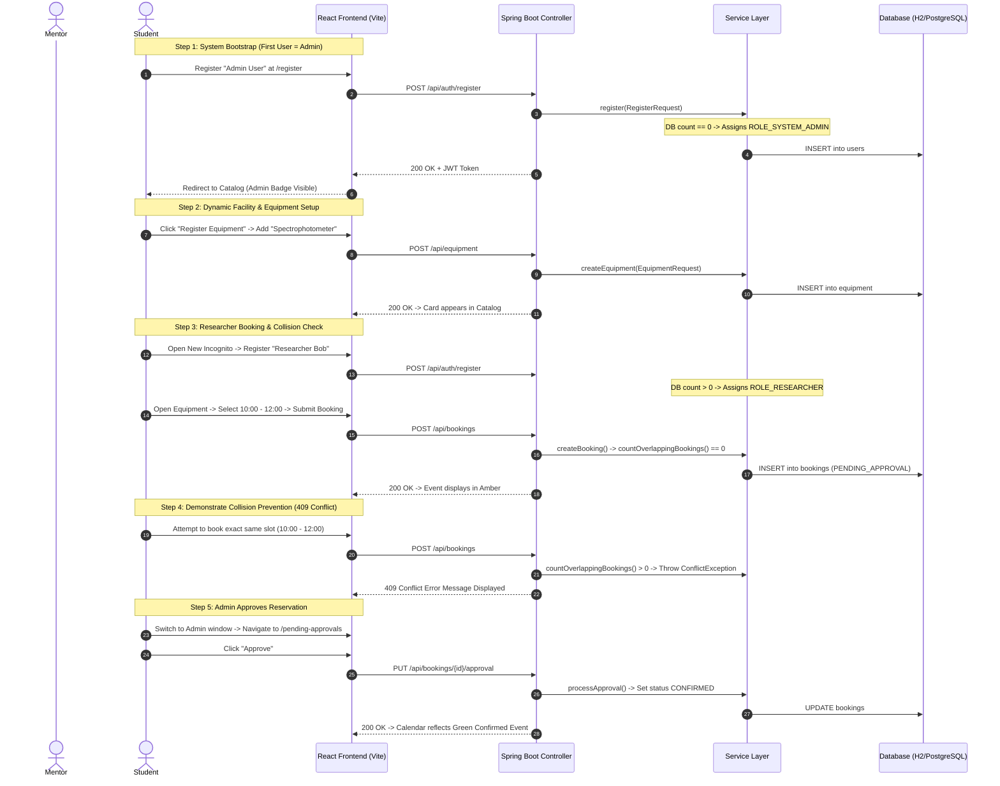

# Milestone 1: Mentor Demonstration Guide

This guide is your step-by-step roadmap for demonstrating the **Lab Resource Utilization Platform (Milestone 1)** to your mentor. It details what is currently implemented, the optimal sequence of actions, what to say, what happens under the hood across the stack, and how to safely trigger edge cases without corrupting your data.

---

## 1. Implemented & Demonstrable Features

The following features are **fully implemented, tested, and verified** in the codebase:

1. **Dynamic Facility Management:** Dynamic registration of Institutions (`POST /api/institutions`) and Departments (`POST /api/institutions/{id}/departments`) without hardcoded records.
2. **Dynamic User Onboarding & RBAC:**
   * **First-User Bootstrap:** The very first registered user is automatically provisioned as `ROLE_SYSTEM_ADMIN`.
   * **Researcher Role Protection:** Subsequent public registrations are strictly assigned `ROLE_RESEARCHER`, preventing unauthorized privilege escalation.
   * **Secure Authentication:** Passwords hashed with BCrypt, stateless authentication via HMAC-SHA256 signed JWTs.
3. **Equipment Inventory Management:**
   * Multi-criteria filtering by Keyword (search in name, model, specs, description), Category, Operational Status, and Institution.
   * Staff-only equipment registration modal with live institution and department association.
   * 5 equipment lifecycle statuses (`AVAILABLE`, `BOOKED`, `UNDER_MAINTENANCE`, `OUT_OF_SERVICE`, `RETIRED`).
4. **Availability & Scheduling Engine:**
   * Interactive calendar powered by **FullCalendar.js** displaying confirmed, pending, and in-use reservations.
   * Reservation modal supporting slot selection, purpose description, and special requirements.
   * **Strict Interval Collision Detection:** Backend mathematically rejects overlapping reservations on the same instrument with `HTTP 409 Conflict`.
   * Maintenance lock: Equipment under maintenance or out of service cannot be reserved.
5. **Role-Protected Lab Manager Approvals Queue:**
   * Protected queue screen (`/pending-approvals`) accessible only to administrative roles (`ROLE_LAB_MANAGER`, `ROLE_SYSTEM_ADMIN`, etc.).
   * Review interface allowing one-click **Approval** (transitions to `CONFIRMED`) or **Rejection** with recorded rationale (transitions to `CANCELLED`).
6. **Researcher Self-Service Portal:**
   * "My Reservations" (`/my-bookings`) view displaying personal booking history, live statuses, and cancellation controls.
   * Profile view and update (`/profile`).

---

## 2. Pre-Demo Preparation Checklist

Complete this checklist 15 minutes before meeting your mentor:

- [ ] **Clean Ports:** Ensure ports `8080` (Backend) and `5173` (Frontend) are free:
  ```powershell
  netstat -ano | findstr ":8080 :5173"
  ```
- [ ] **Launch Backend:** Run `run-backend.bat` or execute:
  ```powershell
  cd d:\Projects\SpringBoard_Internship\backend
  .\mvnw.cmd spring-boot:run
  ```
  *Verify log output ends with:* `Started PlatformApplication in X.XXX seconds`.
- [ ] **Launch Frontend:** In a separate terminal, run `run-frontend.bat` or execute:
  ```powershell
  cd d:\Projects\SpringBoard_Internship\frontend
  npm run dev
  ```
  *Verify log output displays:* `Local: http://localhost:5173/`.
- [ ] **Browser Window:** Open an Incognito/Private browser window at `http://localhost:5173`.
- [ ] **Test Database State:** The app uses an in-memory database by default (`jdbc:h2:mem:lab_resource_db`). It starts completely clean on every fresh restart with no hardcoded mock data.

---

## 3. Step-by-Step Demonstration Sequence



---

## 4. Screen-by-Screen Walkthrough

### Screen 1: Registration (`http://localhost:5173/register`)
* **What you see:** Clean registration form requesting Full Name, Institutional Email, Password, Contact Phone, and Institution/Department selectors.
* **Component in code:** [`Register.jsx`](file:///d:/Projects/SpringBoard_Internship/frontend/src/pages/Register.jsx).
* **Key Interaction:**
  1. Click the **"+ Add New"** button next to Institution.
  2. A modal opens. Enter Institution Name (e.g., `National Research University`) and Code (`NRU`). Click **Create**.
  3. Notice how the dropdown immediately selects your newly created institution without hardcoding.
  4. Submit registration with email `admin@lab.edu` and password `Password@123`.
* **Behind the scenes:**
  * Frontend calls `POST /api/institutions`, handled by [`InstitutionController.java`](file:///d:/Projects/SpringBoard_Internship/backend/src/main/java/com/lab/platform/institution/InstitutionController.java).
  * Frontend calls `POST /api/auth/register`. Because the database user count is 0, [`AuthService.java`](file:///d:/Projects/SpringBoard_Internship/backend/src/main/java/com/lab/platform/auth/AuthService.java#L58-L60) assigns `ROLE_SYSTEM_ADMIN`.
  * A JWT token is returned, stored in `localStorage`, and the user is redirected to `/`.

### Screen 2: Equipment Catalog (`http://localhost:5173/`)
* **What you see:** The search bar, category filter, status filter, and the **"Register Equipment"** button (visible only because your user has administrative privileges).
* **Component in code:** [`EquipmentCatalog.jsx`](file:///d:/Projects/SpringBoard_Internship/frontend/src/pages/EquipmentCatalog.jsx).
* **Key Interaction:**
  1. Click **"Register Equipment"**.
  2. Fill in:
     * Name: `PerkinElmer Lambda 1050+ UV/Vis Spectrophotometer`
     * Category: `Spectrophotometry`
     * Model Number: `L1050+`
     * Hourly Rate: `65.00`
     * Room: `Room Optics-102`
     * Institution & Department: Select the facility you created.
  3. Click **Register Equipment**.
* **Behind the scenes:**
  * Request `POST /api/equipment` is intercepted by [`AuthTokenFilter.java`](file:///d:/Projects/SpringBoard_Internship/backend/src/main/java/com/lab/platform/auth/AuthTokenFilter.java).
  * Security check `@PreAuthorize("hasAnyRole('ROLE_LAB_MANAGER', ...)")` in [`EquipmentController.java`](file:///d:/Projects/SpringBoard_Internship/backend/src/main/java/com/lab/platform/equipment/EquipmentController.java#L39) validates that the JWT contains an administrative authority.
  * Saved in DB table `equipment`. The UI automatically refreshes the catalog card grid.

### Screen 3: Equipment Details & FullCalendar (`http://localhost:5173/equipment/1`)
* **What you see:** Complete technical specifications, location metadata, calibration status box, and the interactive **FullCalendar.js** schedule grid.
* **Component in code:** [`EquipmentDetail.jsx`](file:///d:/Projects/SpringBoard_Internship/frontend/src/pages/EquipmentDetail.jsx).
* **Key Interaction:**
  1. Click on an open future time slot (e.g., tomorrow at 10:00 AM) or click **"Book Time Slot"**.
  2. The booking modal opens with start and end times auto-filled.
  3. Enter Purpose: `Quantitative absorption analysis of nanomaterial thin films`.
  4. Click **Confirm Reservation Request**.
* **Behind the scenes:**
  * Frontend sends `POST /api/bookings` with payload `{ equipmentId, startTime, endTime, purpose }`.
  * [`BookingService.java`](file:///d:/Projects/SpringBoard_Internship/backend/src/main/java/com/lab/platform/booking/BookingService.java#L40) executes collision check `countOverlappingBookings()`.
  * If no conflict exists, status is set to `PENDING_APPROVAL`.
  * Calendar immediately updates with an amber event pill.

### Screen 4: Conflict Prevention (Edge Case Demonstration)
* **What you see:** Submit the booking form a second time using the **exact same start and end times**.
* **Result:** The modal displays an immediate red alert:
  > *"Scheduling conflict: The requested time slot overlaps with an existing booking or pending reservation for this equipment."*
* **Behind the scenes:**
  * [`BookingRepository.java`](file:///d:/Projects/SpringBoard_Internship/backend/src/main/java/com/lab/platform/booking/BookingRepository.java#L26-L34) executes the JPQL query:
    ```sql
    WHERE b.equipment.id = :equipmentId
      AND b.status IN ('PENDING_APPROVAL', 'CONFIRMED', 'IN_USE')
      AND b.startTime < :endTime AND b.endTime > :startTime
    ```
  * Query returns count $> 0$, causing [`BookingService.java`](file:///d:/Projects/SpringBoard_Internship/backend/src/main/java/com/lab/platform/booking/BookingService.java#L80) to throw a `ConflictException`.
  * [`GlobalExceptionHandler.java`](file:///d:/Projects/SpringBoard_Internship/backend/src/main/java/com/lab/platform/common/GlobalExceptionHandler.java#L32) catches it and sends HTTP `409 Conflict`.

### Screen 5: Approvals Queue (`http://localhost:5173/pending-approvals`)
* **What you see:** Administrative review table listing pending reservations, researcher information, scheduled duration, and purpose.
* **Component in code:** [`PendingApprovals.jsx`](file:///d:/Projects/SpringBoard_Internship/frontend/src/pages/PendingApprovals.jsx).
* **Key Interaction:**
  1. Click **Approve**.
  2. A green notification appears: *"Reservation #1 approved successfully!"*.
  3. Navigate back to the equipment calendar. The reservation event color has dynamically shifted from **Amber (Pending)** to **Green (Confirmed)**.

---

## 5. End-to-End API Demonstration (Using PowerShell / curl)

You can demonstrate that the backend is a robust RESTful API independent of the UI by running these commands in PowerShell:

```powershell
# 1. Login and obtain JWT Token
$body = @{ email = "admin@lab.edu"; password = "Password@123" } | ConvertTo-Json
$res = Invoke-RestMethod -Uri "http://localhost:8080/api/auth/login" -Method POST -Body $body -ContentType "application/json"
$token = $res.data.token
Write-Host "Obtained JWT Token: " $token.Substring(0, 30) "..."

# 2. Access Protected Current User Profile
$headers = @{ Authorization = "Bearer $token" }
$profile = Invoke-RestMethod -Uri "http://localhost:8080/api/auth/me" -Method GET -Headers $headers
Write-Host "Authenticated as: " $profile.data.fullName " | Role: " $profile.data.role

# 3. Retrieve Calendar Events directly as JSON
$events = Invoke-RestMethod -Uri "http://localhost:8080/api/bookings/equipment/1/calendar" -Method GET -Headers $headers
Write-Host "Calendar Events Count: " $events.data.Count
```

---

## 6. Mentor Presentation Script (5–7 Minute Verbal Guide)

Use this script during your presentation. Speak naturally and let the screen reflect what you are saying:

> **[Opening - 30 seconds]**
> *"Good morning/afternoon. Today I am presenting Milestone 1 of the Lab Resource Utilization Platform. The core challenge this platform addresses is that research institutions invest heavily in expensive laboratory equipment, but resources often suffer from poor availability visibility, scheduling conflicts, and manual approval bottlenecks.
> In Milestone 1, our primary objective was establishing a robust modular monolith architecture with Spring Boot and React, implementing role-based authentication, dynamic equipment cataloging, and a collision-free calendar booking engine."*

> **[Architecture & Security - 1 minute]**
> *"Before showing the screens, I'd like to highlight our architectural design. On the backend, we use Spring Boot 3 with Java 21+ and a modular package structure. Security is built with Spring Security 6 using stateless JWT tokens signed with HMAC-SHA256, and passwords are encrypted using BCrypt.
> Importantly, we prevent privilege escalation: the first registered user bootstraps the system as an Administrator, while all public registrations are strictly enforced as Researchers."*

> **[Dynamic Data Demonstration - 1.5 minutes]**
> *"To ensure real-world readiness, we do not hardcode any mock records. Let's register a new administrator account. Notice that as I register, I can dynamically create our university and department right in the interface.
> Now logged in as an Administrator, the UI reflects my role badge in the navigation bar. Let's register an analytical instrument: the PerkinElmer UV/Vis Spectrophotometer with its model number, room location, and hourly rate."*

> **[Booking & Collision Prevention - 2 minutes]**
> *"Now let's switch to the perspective of a student or researcher. Let's look at the equipment details page. We have integrated FullCalendar.js, which maps our backend bookings into visual time slots.
> When I click a slot to reserve this instrument, the request is sent to `/api/bookings`. The backend evaluates our interval overlap formula: $(Start_A < End_B) \land (End_A > Start_B)$. If the slot is clear, it is saved as Pending Approval.
> To demonstrate system integrity, if I attempt to book the exact same slot again, the backend intercepts the collision and returns an HTTP 409 Conflict error, protecting our lab from double-bookings."*

> **[Approval Workflow & Closing - 1 minute]**
> *"Finally, returning to the Administrator's view, we see our Approvals Queue. The manager can review the purpose and approve the request. Once approved, the calendar status turns green to indicate a confirmed reservation.
> In summary, Milestone 1 delivers a clean, verified, zero-hardcoded foundation with 9 automated tests passing. In Milestone 2, we will build upon this foundation by adding real-time WebSocket telemetry, utilization heatmaps, and cross-institution sharing. Thank you, and I welcome any questions."*
