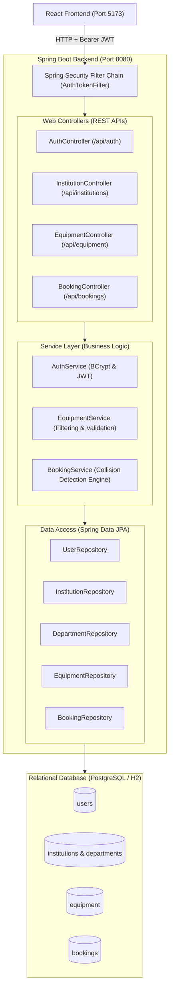
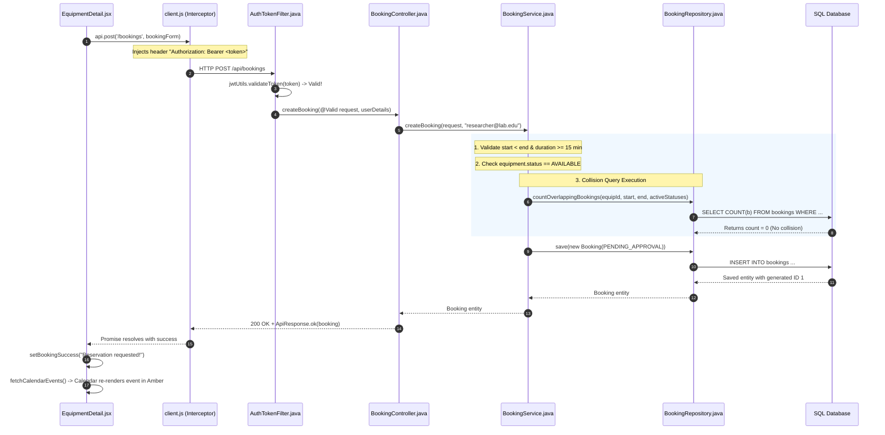

# Milestone 1: Complete Technical Architecture & Code Walkthrough

This document provides a deep, code-level explanation of everything built in Milestone 1 of the **Lab Resource Utilization Platform**. It is written to serve as your permanent technical reference and study guide.

---

## 1. Project Overview & Architectural Strategy

### 1.1 The Core Problem & Objectives
Research institutions and universities spend millions of dollars acquiring advanced laboratory equipment (e.g., spectrophotometers, electron microscopes, NMR spectrometers). In practice, these assets frequently suffer from:
* **Low Visibility:** Researchers in one department have no easy way of discovering available instruments in another department or partner institution.
* **Scheduling Conflicts & Double-Bookings:** Paper logs or informal email reservation threads lead to collisions and wasted preparation time.
* **Unstructured Approvals:** Lab managers lack centralized control over who uses expensive equipment and for what purpose.

**Milestone 1 Objective:** Establish the complete foundational architecture—a secure, multi-tenant modular monolith backend with a responsive React frontend, stateless JWT authentication, role-based access control (RBAC), dynamic inventory management, and an automated conflict-detecting reservation engine.

### 1.2 Technology Stack Justification

| Technology | Role | Why It Was Chosen |
| :--- | :--- | :--- |
| **Java 21+ / Spring Boot 3.4.x** | Backend Framework | Provides enterprise-grade reliability, strict compile-time type safety, mature Object-Relational Mapping (Spring Data JPA / Hibernate), and battle-tested security (Spring Security 6). |
| **React 18 + Vite** | Frontend Framework | Fast build times, hot module replacement (HMR), component-based architecture for reusable UI widgets, and a rich ecosystem for complex data visualization. |
| **Tailwind CSS** | Styling System | Utility-first CSS allowing rapid, responsive, and consistent styling without context-switching between separate CSS files. |
| **PostgreSQL (with in-memory H2)** | Database Layer | PostgreSQL provides ACID compliance and relational integrity. In-memory H2 (in PostgreSQL compatibility mode) provides zero-configuration local execution without file-locking bugs. |
| **FullCalendar.js** | Scheduling UI | Industry-standard calendar library capable of rendering week, day, and month availability timelines directly from REST JSON payloads. |
| **JJWT 0.12.x** | Token Cryptography | Implements standard JSON Web Token creation and verification using HMAC-SHA256 digital signatures. |

### 1.3 Modular Monolith Architecture

Rather than microservices (which require complex Docker networks, distributed transaction managers, and independent deployment pipelines), we use a **Modular Monolith**:
* **Single deployable Spring Boot application.**
* **Strict package boundaries:** Domain logic is organized into isolated packages (`auth`, `institution`, `equipment`, `booking`, `common`, `config`).
* **Clean data flow:** Every package adheres to the uniform `Controller → Service → Repository → Entity` architectural pattern.



---

## 2. Project Directory Structure

```
d:\Projects\SpringBoard_Internship\
├── backend/                               # Spring Boot 3.4.x Backend
│   ├── .mvn/wrapper/                      # Maven Wrapper configuration
│   ├── src/main/java/com/lab/platform/    # Java Source Code
│   │   ├── PlatformApplication.java       # Spring Boot main entry point
│   │   ├── common/                        # Common response envelopes & exceptions
│   │   ├── config/                        # Spring Security, CORS, and DataInitializer
│   │   ├── auth/                          # User entity, JWT, RBAC, AuthService & Controller
│   │   ├── institution/                   # Institution & Department entities, APIs
│   │   ├── equipment/                     # Equipment entity, status enum, search APIs
│   │   └── booking/                       # Booking entity, calendar events, collision logic
│   ├── src/main/resources/
│   │   ├── application.yml                # Dynamic configuration via environment variables
│   │   └── application-postgres.yml       # Production PostgreSQL profile
│   ├── src/test/java/com/lab/platform/    # Automated unit tests (JUnit 5 & Mockito)
│   ├── mvnw.cmd / mvnw                    # Maven wrapper executable scripts
│   └── pom.xml                            # Project Object Model (dependencies & plugins)
├── frontend/                              # React 18 + Vite Frontend
│   ├── src/
│   │   ├── main.jsx                       # React DOM entry point
│   │   ├── App.jsx                        # Router & route definitions
│   │   ├── index.css                      # Tailwind base styles & FullCalendar overrides
│   │   ├── api/client.js                  # Axios client with JWT request interceptor
│   │   ├── context/AuthContext.jsx        # Global reactive authentication state
│   │   ├── components/common/             # Navbar, ProtectedRoute, RoleGuard, StatusBadge
│   │   └── pages/                         # Login, Register, Catalog, Detail, Bookings, Approvals
│   ├── index.html                         # Single Page Application HTML root
│   ├── package.json                       # Node dependencies and scripts
│   ├── vite.config.js                     # Vite dev server configuration & /api proxy
│   └── tailwind.config.js                 # Tailwind CSS configuration
├── run-backend.bat                        # Windows 1-click backend runner
├── run-frontend.bat                       # Windows 1-click frontend runner
└── package.json                           # Root workspace script definitions
```

### Beginner Reading Order: Which Files to Study First
1. **[`backend/src/main/java/com/lab/platform/booking/BookingService.java`](file:///d:/Projects/SpringBoard_Internship/backend/src/main/java/com/lab/platform/booking/BookingService.java):** Study this first to understand how business logic and collision detection work in Java.
2. **[`backend/src/main/java/com/lab/platform/auth/AuthTokenFilter.java`](file:///d:/Projects/SpringBoard_Internship/backend/src/main/java/com/lab/platform/auth/AuthTokenFilter.java):** Shows how HTTP requests are intercepted and verified using JWT tokens.
3. **[`frontend/src/api/client.js`](file:///d:/Projects/SpringBoard_Internship/frontend/src/api/client.js):** Shows how the frontend attaches security tokens to outgoing requests.
4. **[`frontend/src/context/AuthContext.jsx`](file:///d:/Projects/SpringBoard_Internship/frontend/src/context/AuthContext.jsx):** Shows how login state is shared across all React components.
5. **[`frontend/src/pages/EquipmentDetail.jsx`](file:///d:/Projects/SpringBoard_Internship/frontend/src/pages/EquipmentDetail.jsx):** Shows how FullCalendar interacts with backend APIs.

---

## 3. Frontend Architecture Explained from Code

### 3.1 Entry Point & Root Component
* **[`main.jsx`](file:///d:/Projects/SpringBoard_Internship/frontend/src/main.jsx):** Mounts the React component tree into the `<div id="root"></div>` defined in `index.html`. Wraps the app in `<React.StrictMode>`.
* **[`App.jsx`](file:///d:/Projects/SpringBoard_Internship/frontend/src/App.jsx):** Provides the routing backbone using React Router (`<BrowserRouter>`, `<Routes>`, `<Route>`).
  * Wraps everything inside `<AuthProvider>` so that any component can inspect the logged-in user.
  * Public routes: `/` (Catalog), `/equipment/:id` (Details), `/login`, `/register`, `/forgot-password`.
  * Authenticated routes: Wrapped in `<ProtectedRoute>` (e.g., `/profile`, `/my-bookings`).
  * Role-restricted routes: Wrapped in `<RoleGuard allowedRoles={[...]}>` (e.g., `/pending-approvals`).

### 3.2 State Management with Context API
Instead of installing complex Redux libraries, we manage authentication using React's native Context API in **[`AuthContext.jsx`](file:///d:/Projects/SpringBoard_Internship/frontend/src/context/AuthContext.jsx)**:
* **State variables:** `user`, `token`, `isAuthenticated`, `loading`.
* **Session Persistence:** When the page reloads, an `useEffect` hook checks `localStorage.getItem('token')`. If present, the user session is immediately restored without forcing them to re-login.
* **Token Management:** `handleAuthSuccess(authData)` saves the JWT to `localStorage` and updates the React state, causing the entire UI (e.g., Navbar) to re-render reactively.

### 3.3 Axios HTTP Client & Request Interceptors
In **[`client.js`](file:///d:/Projects/SpringBoard_Internship/frontend/src/api/client.js)**, we configure a pre-configured Axios instance:
```javascript
// Request interceptor: automatically attaches JWT token
api.interceptors.request.use((config) => {
  const token = localStorage.getItem('token');
  if (token) {
    config.headers.Authorization = `Bearer ${token}`;
  }
  return config;
});
```
This guarantees that whenever a component calls `api.get()` or `api.post()`, the user's JWT token is automatically transmitted in the `Authorization: Bearer <token>` header without repeating code in every screen.

### 3.4 FullCalendar Integration
In **[`EquipmentDetail.jsx`](file:///d:/Projects/SpringBoard_Internship/frontend/src/pages/EquipmentDetail.jsx)**, we render the interactive schedule grid using `@fullcalendar/react`:
* Passes plugins: `[dayGridPlugin, timeGridPlugin, interactionPlugin]`.
* Loads events directly from backend endpoint `/api/bookings/equipment/${id}/calendar`.
* Color codes events: Confirmed reservations render in Emerald (`#10b981`), while Pending Approvals render in Amber (`#f59e0b`).
* Interactivity: When a user clicks or drags across open time slots on the grid, FullCalendar's `select` callback triggers `handleDateSelect(selectInfo)`, automatically extracting start and end timestamps and launching the reservation modal.

---

## 4. Backend Architecture Explained from Code

### 4.1 Layered Controller-Service-Repository Pattern
The backend strictly adheres to separation of concerns:

```
[HTTP Request] ──> [Controller] ──> [Service Layer] ──> [Repository] ──> [Database]
                         │                 │                  │
                    Validates DTO      Executes Core      JPA / SQL
                   & Path Variables   Business Rules      Execution
```

1. **Controllers (e.g., [`BookingController.java`](file:///d:/Projects/SpringBoard_Internship/backend/src/main/java/com/lab/platform/booking/BookingController.java)):**
   * Annotated with `@RestController` and `@RequestMapping("/api/bookings")`.
   * Accepts `@Valid @RequestBody BookingRequest request` and `@AuthenticationPrincipal UserDetails userDetails`.
   * Never talks directly to the database; delegates immediately to `BookingService`.
2. **Services (e.g., [`BookingService.java`](file:///d:/Projects/SpringBoard_Internship/backend/src/main/java/com/lab/platform/booking/BookingService.java)):**
   * Annotated with `@Service` and `@Transactional`.
   * Contains validation logic (e.g., ensuring start time is in the future, checking minimum 15-minute duration, checking equipment operational status).
   * Orchestrates multi-step operations (e.g., collision checking, saving records, logging audit events).
3. **Repositories (e.g., [`BookingRepository.java`](file:///d:/Projects/SpringBoard_Internship/backend/src/main/java/com/lab/platform/booking/BookingRepository.java)):**
   * Extends `JpaRepository<Booking, Long>`.
   * Spring Data JPA automatically generates SQL implementations at runtime based on method names (e.g., `findByUserIdOrderByStartTimeDesc`).
4. **Entities (e.g., [`Booking.java`](file:///d:/Projects/SpringBoard_Internship/backend/src/main/java/com/lab/platform/booking/Booking.java)):**
   * Annotated with `@Entity` and `@Table(name = "bookings")`.
   * Represents relational tables with `@Id`, `@GeneratedValue`, `@Column`, and `@ManyToOne` relationships.

### 4.2 Security Layer (Spring Security 6 & JWT)
Configured in **[`SecurityConfig.java`](file:///d:/Projects/SpringBoard_Internship/backend/src/main/java/com/lab/platform/config/SecurityConfig.java)**:
* **Stateless Session Management:** `sessionCreationPolicy(SessionCreationPolicy.STATELESS)` instructs Spring not to create HTTP sessions (`HttpSession`) on the server.
* **Filter Chain:** Before Spring's standard `UsernamePasswordAuthenticationFilter`, our custom **[`AuthTokenFilter.java`](file:///d:/Projects/SpringBoard_Internship/backend/src/main/java/com/lab/platform/auth/AuthTokenFilter.java)** inspects incoming requests:
  1. Checks if the `Authorization` header starts with `"Bearer "`.
  2. Uses [`JwtUtils.java`](file:///d:/Projects/SpringBoard_Internship/backend/src/main/java/com/lab/platform/auth/JwtUtils.java) to verify the HMAC-SHA256 signature and check expiration.
  3. Extracts the user's email.
  4. Loads user authorities from [`UserDetailsServiceImpl.java`](file:///d:/Projects/SpringBoard_Internship/backend/src/main/java/com/lab/platform/auth/UserDetailsServiceImpl.java).
  5. Populates `SecurityContextHolder.getContext().setAuthentication(auth)`.
* **Method-Level RBAC:** `@EnableMethodSecurity` activates annotations like `@PreAuthorize("hasAnyRole('ROLE_LAB_MANAGER', ...)")` on sensitive endpoints.

### 4.3 Uniform Error Handling
In **[`GlobalExceptionHandler.java`](file:///d:/Projects/SpringBoard_Internship/backend/src/main/java/com/lab/platform/common/GlobalExceptionHandler.java)**, any uncaught exception thrown anywhere in the application is intercepted by `@RestControllerAdvice`:
* `MethodArgumentNotValidException` (Bean validation failure) $\rightarrow$ Returns HTTP `400 Bad Request` with field-by-field error mappings.
* `ResourceNotFoundException` $\rightarrow$ Returns HTTP `404 Not Found`.
* `ConflictException` $\rightarrow$ Returns HTTP `409 Conflict`.
* `AccessDeniedException` $\rightarrow$ Returns HTTP `403 Forbidden`.

Every error response adheres to the identical JSON structure defined in [`ApiResponse.java`](file:///d:/Projects/SpringBoard_Internship/backend/src/main/java/com/lab/platform/common/ApiResponse.java):
```json
{
  "success": false,
  "message": "Scheduling conflict: The requested time slot overlaps with an existing booking...",
  "data": null,
  "timestamp": "2026-10-22T14:30:00"
}
```

---

## 5. End-to-End Execution Flow: Collision-Protected Booking

This section traces a real transaction from the moment a researcher clicks "Confirm Reservation" on the frontend to the database commit and response.



### Code Trace Reference
1. **Frontend Trigger:** [`EquipmentDetail.jsx`](file:///d:/Projects/SpringBoard_Internship/frontend/src/pages/EquipmentDetail.jsx#L96-L125) (`handleBookingSubmit`)
2. **Backend Entry:** [`BookingController.java`](file:///d:/Projects/SpringBoard_Internship/backend/src/main/java/com/lab/platform/booking/BookingController.java#L23-L28) (`createBooking`)
3. **Collision Algorithm:** [`BookingService.java`](file:///d:/Projects/SpringBoard_Internship/backend/src/main/java/com/lab/platform/booking/BookingService.java#L69-L83)
   ```java
   List<BookingStatus> conflictingStatuses = Arrays.asList(
           BookingStatus.PENDING_APPROVAL,
           BookingStatus.CONFIRMED,
           BookingStatus.IN_USE
   );

   long overlappingCount = bookingRepository.countOverlappingBookings(
           equipment.getId(),
           request.getStartTime(),
           request.getEndTime(),
           conflictingStatuses,
           null
   );

   if (overlappingCount > 0) {
       throw new ConflictException("Scheduling conflict: The requested time slot overlaps...");
   }
   ```
4. **Interval Overlap Query:** [`BookingRepository.java`](file:///d:/Projects/SpringBoard_Internship/backend/src/main/java/com/lab/platform/booking/BookingRepository.java#L26-L34)
   $$\text{Collision condition: } (Start_{\text{existing}} < End_{\text{requested}}) \land (End_{\text{existing}} > Start_{\text{requested}})$$
